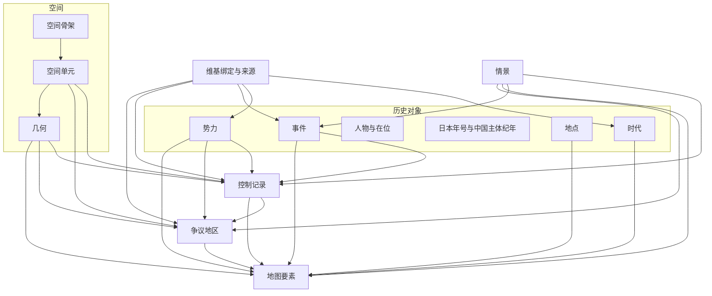

# 日本历史时序地图：数据库逻辑设计

版本：0.1  
日期：2026-10-30  
状态：逻辑结构。物理实现采用本地单文件 SQLite，见 `db/schema.sql` 与 `db/sequence_of_eras.sqlite`。本文仍不规定程序模块。

产品是 Web 与 iOS 共用的历史地图。用户把时间拨到某一天，地图上的势力范围、地点标记、事件和海岸线切换到那一天仍然有效的状态。最小刻度是日期。史前大量事实只有年、世纪或“距今约若干年”的精度，数据库照实保存精度，不把粗略年代伪装成某一天。

默认史实主轴对齐维基百科。日文维基《日本的历史》及其时代框、时代专文是事实核对的第一来源；中文维基作对照；英文维基 *History of Japan* 作第三参照。三语不一致时，默认情景采用日文维基，并保留差异记录。

日期的存储与排序用天文年，展示为公元。对照行同时给出日本纪年和中国纪年。日本用官方年号，年号空档用天皇在位年。中国只用当时的主体王朝：乱世并立的其他政权也入库，默认参照不并列刷出。例如南宋与金并立时，参照写「大宋绍兴××年」，金的年号留在并立轨。

用户口述里的「结绳时期」按绳文时代（縄文時代）理解。绳文一名来自绳纹陶器，位于旧石器时代之后、弥生时代之前。

---

## 1. 本文要定下来的事

地图在任意一天要能回答五件事。

1. 这一天，画面里有哪些势力，各自以什么方式控制哪些范围。
2. 这一天，哪些点、线、面应该画出来，名称和样式是什么。
3. 这一天，维基主轴上有哪些事件，事件落在哪里、涉及哪些势力。
4. 点中一处地方，能顺着时间看出它属于谁、叫什么、是不是都城、国府、城或遗迹。
5. 画面里有哪些登记在案的争议地区，各方如何管理或主张，库如何并列而不作裁决。

结构按这些事拆开。势力、地点、事件是历史对象。争议地区是单独清单。几何是形状。地图要素是某一历史对象在一段时间内的画法。改一个郡的归属不必重画日本，改一个标记的显隐也不必改写事件，登记争议也不必改写全部控制记录。

---

## 2. 参照与取舍

### 2.1 江山时序

对照工程为 [jiangshan-map](https://github.com/DeanChensj/jiangshan-map)。它把中国史做成可拖动的时间轴，值得沿用的做法如下。

| 做法 | 在本设计中的位置 |
| --- | --- |
| 时期是章节，时期内部还有多段疆域 | 时代负责叙事章节；势力范围的变化写在控制记录的有效区间上 |
| 同一画面可以并列多个政权 | 控制记录允许重叠，用控制方式和主张状态区分直辖、臣属、争夺 |
| 城池有出现与消失年份，并有等级，放大后才显示次要点 | 地图要素自带有效区间和显示等级 |
| 地名随时代改变，点地可以回溯政区沿革 | 地点身份稳定，名称、职能、归属各自带时间 |
| 年号和在位者随时间轴变化；并立政权各有自己的年号轨 | 日本官方年号、中国主体王朝各一条默认对照轨；并立年号另轨保存 |
| 边界是示意或复原，需要注明依据 | 每块几何带边界质量和来源 |
| 现代政区可作对照层 | 现代都道府县是一套空间骨架，默认作参照层 |
| 负年份表示公元前，存储中不使用“公元 0 年”的展示 | 存储用天文年；展示换成公元前 / 公元 |

不沿用整幅快照作为逻辑真相。江山时序按阶段保存整张疆域图，适合王朝级、一年一跳的阅读。本产品要拨到某一天，战国式的一日归属变化如果都做成整图快照，郡的一次易手会复制全国几何。逻辑真相改成“谁在哪段时间控制哪个空间单元”。整图多边形可以在以后为了加载速度预先拼好，拼出来的图与控制记录冲突时，以控制记录为准。

### 2.2 维基百科

事件的有无、时间、参与者和默认叙述，对齐维基条目。几何多数不能从维基得到。郡界、海岸线、城址坐标来自地图资料、开放数据和研究复原，单独登记来源。

条目正文不入库。入库的是结构化事实、自撰的短说明、条目标题、语言、章节、修订版本和抓取日期。短说明用于地图卡片，长度控制在几句之内。

### 2.3 年代从哪里开始

时间轴的可拨范围从天文年 -200000 年 1 月 1 日起，向未来开放。这个下限盖得住目前讨论中的最早遗迹，包括岛根县砂原遗迹被联系到约 12 万年前的观点。

默认叙事不从 12 万年前起算。日文维基《日本列岛的旧石器时代》把可确认的现生人类活动放在约 4 万年前以后，并把砂原、金取等更早材料列为仍在讨论的可能性。英文维基 *History of Japan* 写约 3.8 万至 3.9 万年前。默认情景的旧石器章节采用这一档：约 38000 cal BP 量级到绳文土器出现。更早遗迹仍然入库，挂在争议情景，时间轴可以拨到它们的年代区间，默认势力层不把它们画成已证实的人类聚落。

绳文起点在维基各页也不完全一致：时代框常用约公元前 14000 年，旧石器专文用约 16500 BP 的土器年代（青森大平山元 I 遗迹）。两条都保留，默认章节界线取日文维基时代框，专文中的测年写入该界线的依据和不确定度。

---

## 3. 总图

历史对象与画法分开。一条控制记录决定“德川幕府在某一天是否领有某郡”。一个地图要素决定“这一天要不要把这块范围涂出来、用什么颜色、标什么字”。

读取路径是：先定情景和播放头日期，再取出有效区间盖住这一天的控制、地点职能、争议地区和地图要素，最后按图层和显示等级绘制。

---

## 4. 共用的时间值

时间不是单独一张“日期表”。凡是会变化的对象都带同一个时间值。播放头永远是一个具体日期。对象自己的精度可以更粗。

### 4.1 天文年

存储用天文年。

| 天文年 | 展示 |
| --- | --- |
| 2026 | 公元 2026 年 |
| 1 | 公元 1 年 |
| 0 | 公元前 1 年 |
| -1 | 公元前 2 年 |
| -36050 | 公元前 36051 年 |

换算：天文年大于 0 时，公元年等于天文年。天文年小于或等于 0 时，公元前年数等于 `1 - 天文年`。界面、导出的说明文字和年号对照都不出现“0 年”。

### 4.2 时间点

一个时间点表示“来源把这件事放在哪一段”。它有三个位置：最早、最晚、代表日。

| 组成 | 含义 |
| --- | --- |
| 最早的年、月、日 | 区间下界。月、日未知则空着 |
| 最晚的年、月、日 | 区间上界 |
| 代表年、月、日 | 时间轴上的落点，供排序和播放头吸附 |
| 精度 | `day`、`month`、`year`、`decade`、`century`、`millennium`、`kiloyear` |
| 确信度 | `exact`、`circa`、`estimated`、`disputed`、`after_this`、`before_this` |
| 测年方法 | `calendar`、`cal_bp`、`bp_1950`、`years_ago`、`geological`、`historical_text` |
| 原始表达式 | 来源里的写法，例如“约 38000 cal BP”“庆长五年九月十五日” |
| 基准年 | BP 使用 1950。写“距今”时写明文章使用的公元年 |

代表日的取法：

- 精度到日：代表日等于该日，最早与最晚相同。
- 只知月份：最早为该月 1 日，最晚为该月最后一日，代表日取该月 1 日。
- 只知年份：最早为 1 月 1 日，最晚为 12 月 31 日，代表日取 7 月 1 日。
- 更粗的精度：最早与最晚扩到该十年、世纪、千年或千年组的两端，代表日取区间中点所在年的 7 月 1 日。

代表日只负责时间轴落点。判断“这一天是否还处在该对象的有效期内”用最早到最晚的整个区间。旧石器遗址在默认章节里会连续可见数千年，这是精度决定的，不是把遗址写成每天都有新事件。

cal BP 换算：天文年 = `1950 - BP 值`。38000 cal BP 对应天文年 -36050，展示为约公元前 36051 年。来源若写“距今 3.8 万年”而没有声明基准年，按 `years_ago` 保存原始数字和文献出版年，区间至少覆盖“相对 1950”与“相对出版年”两种理解，确信度为 `estimated`。

### 4.3 日序

每个时间点在入库时带三个整数日序：`ordinal_earliest`、`ordinal_latest`、`ordinal_preferred`。日序从天文年 -200000 年 1 月 1 日（proleptic Gregorian）起算，当天为 0，之后每天加 1。Web 与 iOS 使用同一套 proleptic Gregorian 日序。

播放头日期也换成同一个日序。查询“这一天有效”时，比较的是日序，避免公元前、缺月缺日和历法混用直接比年月日。

### 4.4 时间段

| 组成 | 含义 |
| --- | --- |
| 起点 | 一个时间点 |
| 终点 | 一个时间点；仍在继续则空 |
| 终点是否包含当天 | 默认包含 |
| 是否持续到未来 | 令和、现存国家和现代海岸线使用 |
| `query_from` | 起点的 `ordinal_earliest` |
| `query_to` | 终点的 `ordinal_latest`；向未来开放时用一个固定的极大日序 |

某一天 D 有效，当且仅当 `query_from <= D 的日序 <= query_to`。

开放终点的对象在今天之后仍然有效。播放头允许拨过今天，用于看“现行区间还没有终点”。

### 4.5 历法写法

日本在明治五年十二月初三的次日改用格里历，公历日期是 1873-01-01。此前日本史料多为阴阳历。1582-10-15 之前的欧洲日期常为儒略历。

一条历史日期可以挂多条历法写法，排序仍只用第 4.2 节的时间点。

| 组成 | 含义 |
| --- | --- |
| 历法 | `japanese_lunisolar`、`chinese_lunisolar`、`julian`、`gregorian`、`proleptic_gregorian` |
| 年号 | 可空。阴阳历通常挂年号 |
| 年号年 | 元年记为 1。这是来源原文里的年数；推算规则见第 4.6 节 |
| 月、日 | 阴阳历月份按当时月序 |
| 是否闰月 | 阴阳历使用 |
| 原文 | 例如“天正十年六月二日” |

阴阳历已经能可靠换成公历时，时间点的代表日写换算结果，精度为 `day`。换算没有把握时，时间点扩到该和历年可能对应的公历范围，精度降为 `year`，确信度为 `estimated`。同一天的两种写法都保留，例如关原之战保留“庆长五年九月十五日”和公历 1600-10-21。

年号不能覆盖的年份照样可以有公历或约年。日本官方年号、空档里的天皇在位年、中国主体王朝纪年，都按第 4.6 节从同一天换算，不各写一套日期。

### 4.6 纪年对照

天文年和日序回答“这是哪一天”。纪年回答“这一天在日本、在中国各叫哪一年”。纪年从日期推出来，不另存一套会和年号区间打架的年份对照表。

播放头上的三行是：

| 行 | 来源 | 例子 |
| --- | --- | --- |
| 公元 | 天文年换成公历 | 公元 1600 年 10 月 21 日 |
| 日本 | 日本默认纪年轨 | 庆长五年九月十五日 |
| 中国 | 中国主体王朝轨 | 大明万历二十八年，月日按明朝历法另算 |

1949 年 10 月 1 日以后，中国参照与公元是同一套日期。这一行仍可生成，并带标记 `same_as_gregorian`，顶栏不必把公元重复写两遍。

#### 4.6.1 纪年轨、王朝、年号、岁首

纪年轨决定“默认拿哪一家的年号来读这一天”。

| 字段 | 含义 |
| --- | --- |
| `id` | 如 `chronology.japan_official`、`chronology.china_main` |
| 文化 | `japan`、`china` |
| 角色 | `primary` 日本默认；`reference` 中国主体参照；`regional` 并立政权 |
| 所属势力 | 可空。日本官方轨指向发布年号的朝廷；北朝、南朝各指向自己的朝廷 |
| 是否进入顶栏 | 日本默认轨与中国主体轨为是。并立轨只在点开当地或点开该政权时出现 |
| 优先级 | 同一文化有多条轨盖住同一天时，顶栏用优先级最高且角色匹配的那条 |

王朝是纪年的国号，用来拼出「大宋」。它服务于纪年，不等于地图上的势力。明朝若在地图上作为外来势力出现，可以用可选字段连到那个势力，没有地图势力的王朝也可以单独存在。

| 字段 | 含义 |
| --- | --- |
| `id` | 如 `dynasty.song`、`dynasty.liu_song` |
| 纪年轨 | 主体轨或某条并立轨 |
| 谱系 | `main` 或 `regional` |
| 有效区间 | 它被选进这条轨的时间，到日，首尾相接 |
| 展示名 | 写在名称记录里。赵宋的中文展示名是「大宋」 |
| 史实性 | 与人物相同 |
| 来源绑定 | 交接日依据哪一种纪年表 |

年号挂在一条纪年轨和一个王朝上。第 8.5 节的日本年号用同一套字段。

| 字段 | 含义 |
| --- | --- |
| `id` | 如 `era.keicho`、`era.shaoxing` |
| 纪年轨 |  |
| 王朝 |  |
| 有效区间 | 改元生效日到下一次改元的前一日，到日 |
| 是否私年号 | 日本私年号、逸年号为是，只进并立或私年号轨 |
| 岁首历法 | `japanese_lunisolar`、`chinese_lunisolar` 或 `gregorian` |
| 维基绑定 |  |

没有年号时，用在位记录拼帝王纪年。日本年号空档用天皇在位年，中国年号制度以前用周王、秦汉皇帝的在位年。在位记录已在第 8.4 节，这里只规定读法：展示名取王朝展示名加君主名称加在位年数，如「周赧王五十九年」「天智天皇十年」。传说情景里的天皇在位年不进默认日本轨。

岁首决定“年号的第几年”从哪一天开始跳。

| 字段 | 含义 |
| --- | --- |
| 历法 | 与年号上的岁首历法相同 |
| 岁首公历日 | 这一纪年年的第一天 |
| 岁末公历日 | 下一年岁首的前一天 |
| 来源 | 历表或换算依据 |

日本自 1873-01-01 起，岁首改为公历 1 月 1 日。中国自 1912-01-01 起，岁首改为公历 1 月 1 日。此前分别用日本阴阳历、中国阴阳历。两国闰月不一定同年，所以同一个公历日，两国的月、日乃至年号年数都可能不同。日本历的月日不抄到中国纪年上。

#### 4.6.2 从一天读出年号年

给定日期 D 和一条纪年轨：

1. 取区间盖住 D 的那一个年号。主体轨和日本默认轨在任何一天至多一个。
2. 若有年号：找到 D 所属的那个岁首年。年号年数 = 从该年号生效日所在的岁首年算起，经过的岁首年个数。生效当年为元年，记为整数 1。
3. 若无年号而有在位：在位年数用同一套岁首年计算，即位当年为元年。
4. 两者都没有：这一行留空。

年号年数不按「公历年 − 起始公历年 + 1」计算，除非该年号的岁首已经是公历 1 月 1 日。明治六年以后的日本年号、民国纪年满足这个条件，可以整年对齐。大化、庆长、万历、绍兴都不满足：改元常在一年中间，岁首又在公历的一月或二月。

公历上的某一年因此常常跨两个年号。只问「公元 1912 年是日本哪一年」时，返回该年里的全部分段，而不是压成一个年号。1912 年是明治四十五年直到 7 月 29 日，大正元年从 7 月 30 日起。

正统从一家换到另一家时，交接日可以落在新年号的中途。年号年仍按该政权自己的岁首计，不从被选为参照的那一天重新起算。清顺治元年的岁首早于清成为主体参照的那天，交接之后写的仍是顺治元年。

展示格式：

| 情况 | 格式 | 例子 |
| --- | --- | --- |
| 有年号 | 展示名 + 年号 + 年数 | 大宋绍兴十一年、庆长五年 |
| 无年号 | 展示名 + 君主 + 在位年数 | 汉高祖五年、天智天皇十年 |
| 民国 | 民国 + 年数 | 民国十二年 |
| 1949-10-01 起的中国参照 | 与公元相同 | 公元 1949 年 |

年数在数据里是整数。中文展示用「元年、二年、十年」。日文展示用日文维基的年代表记。

展示名是数据，不给国名自动加「大」。约束如下：赵宋用「大宋」，刘宋用「刘宋」，曹魏用「曹魏」，武周用「武周」。后梁、后唐、后晋、后汉、后周保留「后」字。

#### 4.6.3 中国主体王朝

乱世不把并立政权排进默认参照。默认中国轨在每一天只取一个主体，选取规则沿《资治通鉴》的正统顺序，并接到通鉴结束之后：占有中原的一方若不是这条正统，就进并立轨。三国取曹魏，东晋十六国取东晋，南北朝取南朝，581 年隋受禅后改取隋，五代十国取中原五代，辽宋夏金并立时取宋，1279 年宋亡之后取元。

默认参照自共和元年（公元前 841 年）起。此前的夏、商和西周早期不编具体王年，中国行留空。共和以后的交接日以纪年表为准入库；下表是年到年的骨架。

| 主体 | 参照骨架 | 展示名 | 留在并立轨的例子 |
| --- | --- | --- | --- |
| 周 | 前 841–前 256 年 | 周 | 春秋战国诸侯 |
| 秦 | 前 256–前 207 年 | 秦 |  |
| 西汉 | 前 206–公元 8 年 | 汉 | 楚 |
| 新 | 9–23 年 | 新 |  |
| 更始 | 23–25 年 | 汉 |  |
| 东汉 | 25–220 年 | 汉 |  |
| 魏 | 220–265 年 | 曹魏 | 蜀汉、吴 |
| 西晋 | 265–316 年 | 西晋 |  |
| 东晋 | 317–420 年 | 东晋 | 十六国 |
| 宋 | 420–479 年 | 刘宋 | 北魏 |
| 齐 | 479–502 年 | 南齐 | 北魏 |
| 梁 | 502–557 年 | 梁 | 东魏、西魏、北齐 |
| 陈 | 557–581 年 | 陈 | 北齐、北周。581 年起陈改为并立，至 589 年 |
| 隋 | 581–618 年 | 隋 | 陈 |
| 唐 | 618–690 年，705–907 年 | 唐 |  |
| 武周 | 690–705 年 | 武周 |  |
| 后梁至后周 | 907–960 年，五代相接 | 后梁、后唐、后晋、后汉、后周 | 十国 |
| 宋 | 960–1279 年 | 大宋 | 辽、西夏、金、大理；1271–1279 年的元 |
| 元 | 1279–1368 年 | 大元 | 1368 年以后的北元 |
| 明 | 1368–1644 年 | 大明 | 入关前的清 |
| 清 | 1644–1912-01-01 之前 | 大清 | 南明；1912 年退位前的宣统 |
| 中华民国 | 1912-01-01 至 1949-09-30 | 民国 | 伪满、汪政权 |
| 中华人民共和国 | 1949-10-01 起 | 与公元相同 |  |

周亡之后直接接秦王在位年。前 221 年秦称皇帝，展示名仍是「秦」，不另起一条王朝。表里的年份会在改朝当年相接，例如更始与东汉都写到公元 25 年，明与清都写到 1644 年。真正切开的是交接日，不是公历年。西晋与东晋之间、秦降与汉王元年之间若有几天对不上在位记录，中国行留空。空档不用并立政权填。

1644 年明与清的年号在各自历法里互相重叠。主体轨仍只取一家：明的区间收到所选交接日，次日改记清的当年年号。交接日入库时绑定来源。1912-01-01 起主体改为民国，此后到退位日为止的宣统纪年只留在并立轨。

并立轨至少预留：战国诸国、蜀汉、吴、十六国、北朝、辽、西夏、金、十国、南明，以及日本的南北朝北朝或南朝中未被选为默认轨的一方。它们的字段与主体轨相同，顶栏默认不读。

---

## 5. 情景

同一事实若有两个以上认真的说法，放进不同情景，而不是挤在一条记录的备注里。

| 字段 | 含义 |
| --- | --- |
| `id` | 稳定标识，如 `scenario.wikipedia_ja` |
| 名称 | 日文、中文、英文 |
| 种类 | `wikipedia_consensus`、`scholarly_alternative`、`legendary` |
| 是否默认 | 全库只有一个默认情景 |
| 说明 | 这一情景采纳哪一版叙述 |

默认情景 `scenario.wikipedia_ja`：日文维基当前叙述。中文维基与日文维基冲突时，另建 `scenario.wikipedia_zh`，只收录有差异的对象；没有差异的对象不复制。地图默认只读默认情景。用户以后若切换说法，再读其他情景。

邪马台国的畿内说与九州说是两个学术情景，外加维基对争议的综述情景。默认地图采用维基综述：可以标出文献中的候选区域和“位置未定”，不把其中一说画成唯一国界。

传说情景收神武东征、欠史八代一类材料。人物标记 `historicity = legendary` 或 `semi_legendary`。传说情景可以有路线和标记，默认政治层不把它们画成已证实的势力范围。

---

## 6. 来源与外部标识

### 6.1 来源

| 字段 | 含义 |
| --- | --- |
| `id` | 稳定标识 |
| 种类 | `wikipedia`、`wikidata`、`dataset`、`map`、`book`、`article`、`inscription` |
| 题名 | 条目名、书名或数据集名 |
| 语言 | `ja`、`zh`、`en` 等 |
| 定位 | 章节、页码、图幅 |
| 修订或版本 | 维基用修订号；数据集用版本号 |
| 地址 | 永久链接优先 |
| 抓取日期 | 维基必填 |
| 许可 | 几何和数据集必填。维基文本不入库，故不存在正文许可字段 |
| 备注 | 使用了其中哪一张图、哪一层 |

### 6.2 绑定

任何需要核对的对象都可以有多条绑定。

| 字段 | 含义 |
| --- | --- |
| 对象种类、对象标识 | 指向时代、势力、事件、控制、几何、时间点、王朝、年号、岁首等 |
| 来源 | 第 6.1 节 |
| 角色 | `fact_spine`、`wording`、`geometry`、`dating`、`conflict` |
| 摘录要点 | 项目自撰的一句话，写清采纳了什么，不粘贴条目段落 |
| 是否主绑定 | 同一对象、同一角色可以有主绑定 |

规则：

- 默认情景中的每条事件至少有一条日文维基主绑定，角色为 `fact_spine`。
- 中文维基绑定角色可以是 `wording`，供界面措辞对照。
- 几何绑定角色为 `geometry`，与事件绑定分开。
- 日文维基与测年文献不一致时，两条都留，冲突的那条角色为 `conflict`。默认章节界线仍跟维基，测年作为区间的最早 / 最晚。

### 6.3 外部标识

| 字段 | 含义 |
| --- | --- |
| 对象种类、对象标识 | 势力、人物、地点、时代、事件 |
| 体系 | `wikidata`、`geonames`、`gsi`、`cultural_property` 等 |
| 值 | 例如 Wikidata Q 号 |

维基标题会改，内部 `id` 不跟着改。标题放在来源绑定里。

---

## 7. 时代与地域

时代是叙事章节，不是地图状态的主键。同一天可以同时处于多个时代：全国史里的室町、其中的战国、冲绳的第一尚氏、北海道的阿伊努文化期，可以并存。

### 7.1 地域

地域用来说明“这个时代或这支势力主要出现在哪一带”，也用来做分区时代轴。

| 字段 | 含义 |
| --- | --- |
| `id` | 如 `region.hokkaido`、`region.ryukyu`、`region.tohoku`、`region.kyushu_south`、`region.kinai` |
| 父地域 | 可空。琉球可以挂在日本列岛之下，也可以在某些世纪独立成章 |
| 种类 | `archipelago`、`island_chain`、`cultural_region`、`historical_frontier`、`overseas_theater` |
| 代表范围 | 一块示意几何，可随时间更换 |
| 有效区间 | 地域概念本身的使用时期。海外战区只在相应世纪启用 |

初始地域至少包括：列岛总范围、本州—四国—九州核心、东北、南九州、北海道、琉球（含先岛与奄美的差异）、以及按需开启的海外战区。海外战区只服务历史控制的显示，不表示现状主张。

### 7.2 时代

| 字段 | 含义 |
| --- | --- |
| `id` | 如 `period.kofun`、`period.sengoku` |
| 父时代 | 战国可以挂在室町之下。父时代不是强制容器：地域时代可以长于全国父章节 |
| 种类 | `historiographic`、`cultural`、`political`、`regnal`、`regional` |
| 地域 | 全国通史可空，表示列岛通史；北海道、琉球、东北填地域 |
| 有效区间 | 章节起止。精度通常到年或世纪 |
| 情景 | 不同起止说法分属不同情景 |
| 排序 | 时间轴章节的顺序 |
| 维基绑定 | 主条目 |

全国通史在某一天取“地域为空、情景为默认、区间盖住这一天”的时代。地图若把视域中心放在冲绳，同时取冲绳地域时代。两种标签可以一起出现。

时代重叠是常态，不要求把飞鸟从古坟里切干净。英文维基把古坟写作约 250–538 年、飞鸟写作 538–710 年；日文维基时代框把大和时代（含古坟）写到 7 世纪，飞鸟从 592 年起。默认情景采用日文维基时代框，英文维基的 538 年切分记在另一情景。

---

## 8. 势力、人物与年号

### 8.1 势力

势力是图例上的行动者。令制国、郡、都道府县不是势力，它们是空间单元。藩、幕府、王国、大名家、占领当局是势力。

| 字段 | 含义 |
| --- | --- |
| `id` | 如 `actor.tokugawa_shogunate`、`actor.ryukyu_kingdom` |
| 种类 | 见下表 |
| 存在区间 | 成立到终结。文化圈用文化延续区间 |
| 史实性 | `historical`、`semi_legendary`、`legendary`、`disputed` |
| 默认样式 | 图例颜色 |
| 图例分组 | 朝廷、幕府、大名、文化圈、外部势力等 |
| 情景 | 邪马台国只出现在相应情景 |
| 维基绑定 | 主条目 |

种类：

| 种类 | 例子 | 地图含义 |
| --- | --- | --- |
| `archaeological_culture` | 绳文文化、弥生文化、续绳文、擦文 | 文化分布，不是国界 |
| `ethnic_group` | 虾夷、隼人、阿伊努 | 人群活动范围，边界用示意 |
| `clan` | 苏我氏、藤原氏、岛津氏 | 氏族。氏与后来的藩可以有继承关系，但是两个对象 |
| `polity` | 大和朝廷、镰仓幕府、琉球王国、大日本帝国、日本国 | 政权 |
| `domain` | 萨摩藩、会津藩 | 藩本身是行动者 |
| `religious_power` | 石山本愿寺、一向一揆 | 在相应年代进入势力层 |
| `foreign_power` | 明、清、葡萄牙商馆、美国 | 只记录它在本图范围内的存在，不绘制该国全境 |
| `occupation_authority` | 盟军总司令部占领当局、琉球列岛美国民政府 | 占领区间 |
| `modern_state` | 日本国 | 可与 `polity` 二选一。同一实体只用一个 `id`，种类取更具体的那个 |

氏族与政权分开。德川氏、江户幕府、尾张德川家的藩，是三条记录，用势力关系连接。岛津氏、萨摩藩、他们对琉球的支配，也分开。

### 8.2 势力关系

| 字段 | 含义 |
| --- | --- |
| 甲方、乙方 | 两个势力 |
| 关系 | `successor`、`split_from`、`merged_into`、`vassal_of`、`allied_with`、`rival_of`、`dual_subordinate_of`、`renamed_to`、`occupies` |
| 有效区间 | 关系存续的时间 |
| 确信度 | 与时间点相同的一套 |
| 情景 | 有争议的臣属关系放进对应情景 |
| 依据事件 | 可空，指向建立或解除这层关系的事件 |

琉球王国在 1609 年之后对萨摩藩和明朝（后来是清朝）的双重从属，用两条 `dual_subordinate_of`，区间分开。这是控制方式，不是把琉球合并进萨摩的几何里。

### 8.3 人物

人物服务于“这一天谁在位”，以及事件参与者。不做完整传记。

| 字段 | 含义 |
| --- | --- |
| `id` | 如 `person.tokugawa_ieyasu` |
| 生、卒 | 时间点，允许未知和传说 |
| 史实性 | 与势力相同 |
| 维基绑定 | 主条目 |

名称放在第 10 节的名称记录里。在位天皇在当代不把年号当作个人姓名来存储；年号是年号对象，谥号和御名是不同的名称种类。

### 8.4 在位与任职

| 字段 | 含义 |
| --- | --- |
| 人物 | 可空仅当职位空缺需要被表示，默认都有人物 |
| 势力 | 朝廷、幕府或某个藩 |
| 职位 | `emperor`、`retired_emperor`、`sessho`、`kampaku`、`shogun`、`daimyo`、`kokushi`、`prime_minister`、`governor` 等 |
| 代次 | 可空，如天皇代数 |
| 有效区间 | 到日。同日交替时，终点的“是否包含当天”用来切开前后任 |
| 情景 | 南北朝两方天皇都入库，分属默认情景中的两条并存记录，不合并成一人 |

时间轴顶栏的默认人选：

- 朝廷一侧取当天在位的天皇。
- 若当天存在征夷大将军，同时显示将军。
- 查看某一藩的卡片时，改显示该藩藩主。
- 传说情景的神武以后诸天皇不进入默认顶栏，除非播放头明确处于传说情景。

### 8.5 日本年号在纪年轨中的位置

日本年号、中国年号、王朝展示名和岁首共用第 4.6 节。本节只规定日本这一侧怎样放进轨里。

日本默认轨 `chronology.japan_official` 对齐日文维基的年号列表，角色为 `primary`。大化（645 年）以前没有连续年号。654 与 686 之间、686 与 701 之间也有空档。空档用天皇在位年，不补造官方年号。私年号、逸年号进单独的轨，不进默认轨。

南北朝时期北朝与南朝各有一条完整年号轨。默认轨的选择是顶栏约定，不表示另一条无效。查看某地时，日本纪年改读当天实际统治该地的那一条轨；时间轴刻度本身仍走默认轨。中国参照始终走主体王朝轨，不因为地图中心移到日本某地而改成辽、金或北魏。

明治以后一世一元。明治年号始于 1868-10-23，政治史章节“明治时代”常从 1868 年的王政复古写起。年号区间与时代区间分开存储，各自使用自己的端点。

同日交替时，用“终点是否包含当天”写成实际生效日，不另定一条“一律次日改元”的总规则。按通行的公历对照：明治的最后一天是 1912-07-29，大正始于 1912-07-30；大正的最后一天是 1926-12-24，昭和始于 1926-12-25；昭和终于 1989-01-07，平成始于 1989-01-08；平成终于 2019-04-30，令和始于 2019-05-01。维基若对某一次改元的记日不同，改那一条年号的实例。

---

## 9. 空间、几何与控制

### 9.1 空间骨架

骨架是一套可以拼图的区域版本。同一历史时期只使用声明过的骨架，避免把幕末的郡界说成弥生的国界。

| 字段 | 含义 |
| --- | --- |
| `id` | 如 `framework.ryoseikoku`、`framework.late_edo_district`、`framework.prefecture_current` |
| 种类 | `cultural_schematic`、`province`、`district`、`domain_holding`、`prefecture`、`coastline`、`custom` |
| 适用区间 | 这套骨架适合被拿来做底的时间 |
| 边界质量 | 整套骨架的默认质量 |
| 来源与许可 | 数据集必填 |
| 说明 | 写明它是当时边界还是后代材料的近似 |

预期中的骨架，入库时再绑定真实数据：

| 骨架 | 用途 |
| --- | --- |
| 旧石器至绳文的文化分区示意 | 粗轮廓，质量为 `schematic` |
| 古海岸线序列 | 末次冰期最盛期、绳文海进高峰、历史时期稳定海岸、现代海岸 |
| 令制国 | 国界随分割、合并改变，因此国单元自己还有几何版本 |
| 郡 | 战国势力的主要拼图原子。若使用幕末村域回推的郡界，质量标为 `modern_proxy` |
| 藩领 | 江户时代，一块藩领可以不连续 |
| 都道府县 | 废藩置县以后，含后来的合并与冲绳返还 |
| 现代参照 | 对照层，不参与历史归属 |

令制国从 7 世纪后半到 8 世纪初逐步形成，大宝律令（701 年）是制度上的明确节点。此前的“国”和国造辖区用另一套 `custom` 或 `cultural_schematic` 骨架，不复用令制国标识。

### 9.2 空间单元

| 字段 | 含义 |
| --- | --- |
| `id` | 如 `unit.province.owari`、`unit.prefecture.okinawa` |
| 骨架 | 所属骨架 |
| 种类 | `culture_area`、`circuit`、`province`、`district`、`domain_part`、`prefecture`、`coast_region`、`custom_region` |
| 存在区间 | 这个单元作为区划存在的时间。加贺国从越前分出之后才存在 |
| 现代对照 | 可空，指向一个现代都道府县或市町村，仅供卡片说明 |

隶属也带时间。武藏国在 771 年从东山道改属东海道，是隶属记录的变更，不是把“武藏”换成另一个地点。

| 隶属字段 | 含义 |
| --- | --- |
| 子单元、父单元 | 郡属于国，国属于道 |
| 有效区间 | 这层隶属的起止 |
| 关系 | `part_of`、`seat_of` |

### 9.3 几何

几何只描述形状。历史含义写在使用它的控制记录或地图要素上。

| 字段 | 含义 |
| --- | --- |
| `id` | 几何标识 |
| 形状类型 | `point`、`multi_point`、`line`、`multi_line`、`polygon`、`multi_polygon` |
| 坐标系 | WGS 84，经度在前，纬度在后 |
| 细节等级 | `overview`、`regional`、`detail` |
| 由哪一块简化而来 | 低细节指向高细节，便于 Web 与 iOS 按比例尺选取 |
| 范围框 | 西、南、东、北 |
| 代表点 | 标注和定位用 |
| 有效区间 | 这块形状本身可用的时间。单元改界则新开一块几何 |
| 边界质量 | `schematic`、`approximate`、`reconstructed`、`modern_proxy`、`surveyed` |
| 几何正文 | GeoJSON 几何对象。本文不规定它存在文件、文档还是二进制大对象里 |
| 来源绑定 | 角色为 `geometry` |

同一骨架、同一细节等级下，相邻且应当拼严的单元共用边界顶点。缝隙和重叠视为数据错误，争夺地区除外。争夺不靠把边界画歪来表示，而靠两条控制记录叠加。

古海岸线是几何，挂在海岸线骨架上，作为底图要素，不作为任何势力的领土。

点位坐标带一个“可靠半径”，单位是米。城址清楚则半径小；只知道在某一郡内则半径大，必要时退回郡的代表点，并在要素上标明是近似位置。

### 9.4 控制记录

控制记录是势力范围的逻辑真相。

| 字段 | 含义 |
| --- | --- |
| `id` | 稳定标识 |
| 情景 | 默认只显示默认情景 |
| 势力 | 行动者 |
| 空间单元 | 与“直接几何”二选一 |
| 直接几何 | 没有合适骨架时使用，例如示意性的文化分布、战役占领带、海外租借地 |
| 有效区间 | 可到日 |
| 控制方式 | 见下表 |
| 主张状态 | `preferred`、`competing`、`rejected` |
| 涂色优先级 | 重叠时谁作为底色，数字小的在下 |
| 引起变化的事件 | 可空 |
| 边界质量 | 可覆盖几何自带的质量 |
| 来源绑定 | 这条归属依据什么 |

控制方式：

| 方式 | 画法含义 |
| --- | --- |
| `direct` | 直接统治，实色 |
| `administered` | 中央派官的管治，如国司支配，实色偏浅 |
| `delegated` | 委托在地首领，如国造、守护 |
| `domain` | 藩领、知行 |
| `vassal` | 从属，颜色跟随宗主，图例中仍可点出从属者 |
| `alliance` | 同盟，不用领土实色，用线或图例 |
| `nominal` | 名义上的最高权，如武家政权时期的朝廷对全国 |
| `dual` | 双重从属的其中一侧 |
| `occupation` | 军事占领 |
| `sphere` | 影响力所及，斜线或淡色 |
| `claimed` | 主张但未实际控制 |
| `contested` | 争夺中 |
| `cultural` | 文化分布，明确不是政治边界 |
| `presence` | 商馆、使节据点、居留地，通常是点或很小的面 |
| `uncertain` | 文献不足以判断 |

约束：

- 空间单元和直接几何恰好填写一个。
- 同一单元、同一情景、区间重叠的两份 `direct`，至少一份的主张状态是 `competing`，或者控制方式改为 `contested`。
- `cultural` 不参与“这里属于哪个政权”的点选结果。
- `nominal` 可以和别人的 `direct` 重叠。朝廷在江户时代对列岛的名义地位与各藩的实控同时为真。
- 传说情景才允许史实性为 `legendary` 的势力拥有 `direct`。

势力范围在某一天的形状，等于这一天该势力全部有效控制的空间单元几何，加上它的直接几何。`vassal` 是否并入宗主的涂色，由显示模式决定：默认“实控图”按直接统治者涂色，并在图例保留宗主；“宗主图”把 `vassal` 并进宗主。两种模式读同一批控制记录。

海外控制使用 `region` 为海外战区的单元或直接几何，放在独立图层。1945 年之前的境外控制有终点。播放头回到今天时，这些区间已经结束，不会继续涂色。

现状有争议的岛屿、海域和地位争议区，一律先在第 9.5 节的争议地区表登记。管理与主张仍用控制记录的 `direct`、`claimed`、`contested` 等表达，并回指争议地区标识。数据库只并列各方说法与来源，不作主权裁决。

### 9.5 争议地区

争议地区是单独一张逻辑表。它把“这里存在未了结的领土主张或地位争议”登记成稳定对象，不靠从控制记录里临时猜。普通历史争夺（例如战国某郡易手）不进这张表；表里收录的是产品需要长期对照、跨时间显示的争议区，尤其是日本与周边国家的现行或近现代争议，以及按产品要求纳入的琉球。

控制记录回答某一天谁在管理、谁在主张。争议地区回答这块地方是否属于争议清单、涉及哪些当事方、各方怎么称呼它、争议从哪一天起算、地图上如何单独提示。

#### 9.5.1 争议地区本体

| 字段 | 含义 |
| --- | --- |
| `id` | 如 `dispute.senkaku_diaoyu`、`dispute.ryukyu` |
| 种类 | `island_group` 岛群；`island` 单岛；`sea_area` 海域或专属经济区焦点；`archipelago_status` 列岛地位争议；`land_border` 陆界片段 |
| 空间单元 | 可空，指向都道府县、郡或其他单元 |
| 直接几何 | 可空，岛链、领海示意或海域焦点。与空间单元至少填一个 |
| 有效区间 | 争议被登记为“需要对照显示”的起止。现行争议终点开放 |
| 状态 | `active` 现行；`historical` 已有条约或交接结束但仍保留历史卡片；`dormant` 主张仍在但默认地图不强调 |
| 默认显示名策略 | `neutral_id` 只用内部中性名；`all_party_names` 并列各方常用名；`wikipedia_ja_title` 默认用日文维基标题，并在卡片列出其他叫法 |
| 敏感度 | `standard` 或 `high`。`high` 的区域在默认图层用争议样式，卡片必须列出各方来源 |
| 情景 | 默认情景收录登记清单；若某一方叙事只存在于另一情景，当事方记录填那个情景 |
| 短说明 | 自撰一两句，写明“存在多方主张，本库不作裁决” |
| 维基绑定 | 至少绑定日文维基相关条目；中文、英文、其他当事方语言条目按可取得情况补齐，角色为 `fact_spine` 或 `wording` |

内部 `id` 使用中性罗马字组合，不单独采用任何一方的主权称谓作为唯一标识。各方正式名称全部放进名称记录，并标明所属当事方。

#### 9.5.2 争议当事方

一条争议地区对应多条当事方记录。

| 字段 | 含义 |
| --- | --- |
| 争议地区 |  |
| 势力 | 现代国家或历史政权，如日本国、中华人民共和国、中华民国、大韩民国、俄罗斯联邦，以及琉球相关历史政权 |
| 角色 | `administers` 实际管理；`claims_sovereignty` 主权主张；`claims_historical` 历史权利或地位主张；`recognizes_other` 承认另一方说法；`interested_party` 利益相关但未正式主张 |
| 所用名称 | 指向名称记录。例如同一岛群在日方、中方、台方名称不同 |
| 有效区间 | 该角色在这段时间成立 |
| 主张状态 | `preferred`、`competing`、`rejected`。与控制记录上的主张状态同义，便于对照 |
| 关联控制记录 | 可空。把“这一天的管理或主张”指回具体控制区间 |
| 来源绑定 | 该当事方说法的出处，各方各自绑定，不互相覆盖 |

约束：

- 同一争议、同一天，`administers` 可以有一方或多方分段；现行实际管理若有公认管理者，仍只记管理事实，不表示裁决主权。
- 至少两方具有 `claims_sovereignty`、`claims_historical` 或 `administers` 之一，才登记为争议地区。
- 各方来源绑定不得合并成一条“综合结论”。

#### 9.5.3 争议时间节点

| 字段 | 含义 |
| --- | --- |
| 争议地区 |  |
| 事件 | 可指向已有事件，也可只写节点说明 |
| 节点种类 | `claim_begins`、`administration_changes`、`treaty`、`occupation_begins`、`occupation_ends`、`status_change`、`incident` |
| 时间点 | 到日或到年 |
| 说明 | 自撰短句 |
| 来源绑定 |  |

节点用于卡片时间线，不替代控制记录。控制区间变更仍以控制记录为准；节点解释“为什么这一天开始成为争议对照对象”。

#### 9.5.4 初始登记清单

下列条目是产品初始就要进表的对象。正式入库时补几何、名称和维基修订号。清单可增补，不表示穷尽世界上所有涉日争议。

| `id` | 中性指称 | 种类 | 主要当事方（角色概要） | 备注 |
| --- | --- | --- | --- | --- |
| `dispute.northern_territories` | 北方四岛 / 南千岛争议区 | `island_group` | 日本：主张与部分历史管理叙述；俄罗斯：实际管理与主张 | 日俄之间的岛屿争议 |
| `dispute.takeshima_dokdo` | 竹岛 / 独岛争议区 | `island_group` | 日本：主张；韩国：实际管理与主张 | 日韩之间的岛屿争议 |
| `dispute.senkaku_diaoyu` | 尖阁 / 钓鱼岛争议区 | `island_group` | 日本：实际管理与主张；中国：主张；台湾当局：主张 | 多方岛屿与周边海域主张 |
| `dispute.ryukyu` | 琉球 | `archipelago_status` | 日本：现行都道府县管理；其他当事方或叙事：历史地位、归属或前途主张按来源分别登记 | **按产品要求必须入库**。覆盖琉球王国、萨摩支配、琉球处分、美治、1972 年施政权返还之后的地位争议与相关主张，不只记某一个小岛 |

琉球与北方四岛、竹岛、尖阁同属争议地区表，但种类不同：前三者以岛群领土主张为主；琉球以列岛地位与历史归属叙事为主，空间范围可以覆盖整条琉球弧或其中需要单独对照的岛群。冲绳县作为空间单元仍正常存在；争议地区记录额外说明“此处进入争议对照清单”。

已经结束、且各方不再作为现行争议对照的历史占领，默认不进这张表，只保留控制记录与事件。若产品以后要把某段历史争夺也做成对照卡片，再把状态标为 `historical` 补登。

#### 9.5.5 与图层、查询的关系

争议地区默认进入图层 `layer.dispute`，排序放在政治层与事件层之间，例如顺序 45。默认打开。样式与普通实控涂色分开：斜线、虚线或争议图例，避免被误读成已裁决国界。

某一天的读取结果增加：

- 有效区间盖住该日、且状态为 `active` 或按显示选项包含 `historical` 的争议地区。
- 各方角色、所用名称、关联控制记录。
- 点选落在争议几何内时，先展示争议卡片，再列出当天管理与主张控制记录。

默认情景并列日文维基与其他已绑定来源对“谁在管理、谁在主张”的叙述。库不输出“本产品认定主权属于某某”。

---

## 10. 地点、职能与名称

### 10.1 地点

地点是稳定身份。藤原京、平城京、长冈京、平安京是四个地点，不是同一个点在移动。大和朝廷的都城从一处迁到另一处，写在驻地记录里。

| 字段 | 含义 |
| --- | --- |
| `id` | 如 `place.heiankyo`、`place.iwajuku` |
| 种类 | `archaeological_site`、`settlement`、`palace`、`capital`、`castle`、`kofun`、`shrine`、`temple`、`port`、`battlefield`、`city`、`island` |
| 代表坐标 | 经度、纬度、可靠半径 |
| 坐落单元 | 可空。用于“位于尾张国”这类说明，带时间 |
| 发现或认定 | 可空，指向近现代的研究事件。遗迹的历史显示区间用人类活动时期，不用发掘年份 |

岩宿遗迹的标记在旧石器的人类活动区间内显示。1949 年相泽忠洋发现遗物，是另一条近现代事件，默认不放在古代图层。

一个遗迹有多段人类活动时，用多条职能或地图要素区间，例如岩宿 I 与岩宿 II，而不是拆成两个无关地点。若文化层在空间上分开，再拆地点。

### 10.2 驻地

| 字段 | 含义 |
| --- | --- |
| 势力 | 谁把这里当据点 |
| 地点 | 哪里 |
| 种类 | `primary`、`secondary`、`temporary`、`ritual` |
| 有效区间 | 迁都当天用“是否包含当天”切开 |

### 10.3 地点职能

| 字段 | 含义 |
| --- | --- |
| 地点 |  |
| 职能 | `capital`、`kokufu`、`castle_town`、`daimyo_seat`、`ritual_center`、`port`、`occupation_hq`、`site_occupation` |
| 相关势力 | 可空。文化层可以没有政权 |
| 有效区间 |  |
| 情景 |  |

职能和驻地可以同时存在。平安京既是朝廷的 `primary` 驻地，也具有 `capital` 职能。镰仓幕府成立后，京都仍可以是朝廷驻地，镰仓是幕府驻地。

### 10.4 名称

时代、势力、人物、年号、地点、空间单元、事件、图层共用一套名称。

| 字段 | 含义 |
| --- | --- |
| 对象种类、对象标识 |  |
| 语言 | `ja`、`ja_reading`、`romaji`、`zh_hans`、`zh_hant`、`en` |
| 文字 | 名称本身 |
| 种类 | `common`、`official`、`historical`、`posthumous`、`personal`、`short`、`scholarly` |
| 有效区间 | 可空。江户与东京分属不同区间 |
| 是否主名 | 同一对象、同一语言、区间重叠时，主名至多一个 |
| 情景 | 不同说法的名称可以不同 |

日文主名使用维基条目的现行标题。中文主名优先用中文维基标题；中文维基没有对应条目时，用项目自撰译名，并在绑定里注明没有中文条目。

---

## 11. 事件

事件是维基主轴的载体。领土变化若能对应到某个事件，控制记录指向它。拨到那一天时，范围变化和事件同时出现。

### 11.1 事件本体

| 字段 | 含义 |
| --- | --- |
| `id` | 如 `event.sekigahara`、`event.taika` |
| 种类 | `archaeological`、`political`、`military`、`diplomatic`、`institutional`、`succession`、`disaster`、`cultural`、`territorial`、`demographic` |
| 有效区间 | 一天的战事精度为 `day`；一场战争可以是父事件，战役是子事件 |
| 重要度 | 1 到 5。1 是时代分界级，5 是很次要 |
| 时间轴策略 | `always`、`zoom`、`chapter`。决定默认会不会在粗时间轴上出现，与历史重要性分开 |
| 短说明 | 自撰，不复制维基正文 |
| 对齐程度 | `follows`、`partial`、`disputed` |
| 情景 |  |
| 维基绑定 | 默认情景必须有日文维基主绑定 |

父事件用事件关系 `part_of` 连接。文禄庆长之役是父事件，具体战役是子事件。父事件的区间盖住子事件。

重要度只管历史重量。显示策略避免一天之内挤进所有 5 级事件：默认播放只取重要度 1 至 3，放大或打开“全部事件”后再取 4 和 5。

### 11.2 参与者与地点

| 参与 | 含义 |
| --- | --- |
| 事件 |  |
| 势力或人物 | 二选一或同时给出 |
| 角色 | `initiator`、`opponent`、`subject`、`affected`、`victor`、`defeated` |
| 说明 | 可空 |

| 地点 | 含义 |
| --- | --- |
| 事件 |  |
| 地点或空间单元或几何 | 至少一种 |
| 角色 | `primary`、`theater`、`origin`、`destination` |
| 情景 | 地点有争议时分情景 |

进军、遣唐使航路、铁路线用第 12 节的线状要素，事件只引用它们。

### 11.3 与控制记录的关系

领土变化类事件保存之后，受影响的控制记录填写“引起变化的事件”。一条事件可以引起多条控制变化，例如废藩置县在 1871-08-29 结束大量藩的 `domain` 控制，并开始县的行政单元。

控制区间的端点与事件日期不一致时，以事件的时间点为准改控制区间，并在来源要点里写明原资料只有年份。资料确实只有年份时，不强行改成事件当天，而是把控制精度保持在 `year`，让整个公历年都落在有效区间里。

### 11.4 默认主轴覆盖的事件类型

下面是内容范围，不是已经录入的数据。选取标准：日文维基《日本的历史》正文使用的节点，加上时代专文中的分界事件。

- 史前：可确认的人类到来、地域扩展、土器出现、稻作传播、金属器出现。以文化事件和遗迹为代表，不编造部落国家。
- 古坟至飞鸟：前方后圆坟所代表的政治集中、佛教传来、苏我与物部、推古朝、大化改新、壬申之乱、大宝律令。
- 奈良与平安：迁都平城京、迁都平安京、摄关、庄园、平氏政权、源平合战。
- 镰仓至室町：幕府建立、承久之乱、两次蒙古袭来、建武新政、南北朝、应仁之乱、战国大名。
- 织丰至江户：本能寺、小田原之战、关原、幕府建立、锁国相关法令、黑船、大政奉还、戊辰战争。
- 明治以后：废藩置县、琉球处分、帝国宪法、日清日俄、关东大地震、九一八、对华战争扩大、太平洋战争、终战、占领结束、冲绳返还、平成与令和的交替。

战争和占领只作为历史区间入库，区间有终点。现状图层不继承这些区间。

---

## 12. 地图要素

地图要素是某一天实际绘制的对象。标记是点状地图要素。势力范围是面状地图要素。道路、航线和战线是线状地图要素。

### 12.1 图层

| 字段 | 含义 |
| --- | --- |
| `id` | 如 `layer.political` |
| 排序 | 从底到顶 |
| 默认是否打开 |  |
| 图例标题 | 多语言名称 |

初始图层从底到顶：

| 顺序 | 图层 | 默认 | 内容 |
| --- | --- | --- | --- |
| 10 | `paleogeography` | 开 | 古海岸线、陆桥示意 |
| 20 | `culture` | 史前开，古代以后关 | 文化分布 |
| 30 | `political` | 开 | 实控范围 |
| 40 | `contested` | 开 | 争夺和双重从属的叠加 |
| 50 | `admin` | 关 | 令制国、郡、县界 |
| 60 | `routes` | 关 | 驿路、航路、进军、铁路 |
| 70 | `sites` | 开 | 遗迹、古坟 |
| 80 | `places` | 开 | 都城、国府、城、都市 |
| 85 | `dispute` | 开 | 争议地区，与实控涂色分开 |
| 90 | `events` | 开 | 当天有效的事件标记 |
| 100 | `modern_reference` | 关 | 现代都道府县对照 |
| 110 | `legendary` | 关 | 传说情景 |
| 120 | `overseas` | 播放头进入相应区间时可用 | 境外控制，不替代本土图 |

### 12.2 要素

| 字段 | 含义 |
| --- | --- |
| `id` |  |
| 图层 |  |
| 情景 |  |
| 几何来源 | `authored` 或 `derived` |
| 历史对象 | 种类加标识：势力、地点、事件、控制、路线、海岸线版本 |
| 几何 | 直接绘制时必填。`derived` 的面可以空着，由控制记录现算 |
| 有效区间 | 必须落在历史对象的区间之内，可以更短 |
| 样式 | 可空，空则继承势力的默认样式 |
| 标注 | 指向一条名称，或一段只用于地图的短标注 |
| 显示等级 | 1 始终显示，2 放大后显示，3 再放大才显示 |
| 重要度 | 与事件重要度同一套，供疏密控制 |
| 交互 | 点开后打开哪个对象的卡片 |

`derived` 要素表示“请把这些控制记录拼成一个面”。它记录势力、控制方式过滤条件和区间。几何正文可以后补，后补只为了加快读取。控制记录变更后，后补几何失效，直到重新生成。

`authored` 用于遗迹点、都城点、文化示意面、海岸线、路线。这些没有郡级原子可拼。

### 12.3 一天之内标记会怎样变

播放头从 D 移到下一天，只处理 `query_from` 或 `query_to` 落在这两天之间的对象。可能的变化都落在下面几类里。

| 变化 | 数据上的表现 |
| --- | --- |
| 出现或消失 | 地图要素的区间端点 |
| 挪动 | 同一地点一般不挪；都城迁移是旧驻地结束、新驻地开始。真正的坐标修正是新几何替换旧几何 |
| 改名 | 名称的有效区间 |
| 改色或改控制方式 | 旧控制结束，新控制开始；样式跟着势力或控制方式走 |
| 变形 | 空间单元换一块几何，或控制从一组单元改到另一组 |
| 分裂与合并 | 势力关系加上两组控制的交接 |
| 海岸线更换 | 海岸线要素的区间端点。史前变化按地质阶段，不按天 |
| 事件闪现 | 事件区间。单日战役只在那一天进入默认事件层；战争父事件在整个区间内可作为一个标记或只出现在列表中 |

事件标记的历史区间就是事件本身的区间。界面若希望在前后几天仍能看见一场战役，那是阅读辅助，不写回事件日期。

### 12.4 线

| 字段 | 含义 |
| --- | --- |
| `id` |  |
| 种类 | `road`、`sea_lane`、`march`、`mission`、`railway`、`boundary_work` |
| 几何 | 线 |
| 有效区间 |  |
| 相关势力、相关事件 | 可空 |
| 显示等级 |  |

七道驿路、遣唐使航路、文禄庆长之役的行进、近代铁路都用这一对象。线是地图要素的一种历史对象，绘制时仍落到某个图层。

---

## 13. 某一天读出什么

下面是逻辑结果，不是接口。Web 与 iOS 以后读到的应当是同一份内容。

输入：情景 S，日期 D，打开的图层，画面范围，显示等级上限。

输出：

1. 全国通史时代，以及与画面相交的地域时代。
2. 三行纪年。公元由 D 直接换算。日本行读默认纪年轨；若查看某地且该地当天另有年号轨，日本行改读当地轨。中国行读主体王朝轨。某行没有年号也没有在位年时，该行留空。并立轨不进这三行，随政权或地点卡片另给。
3. 当天在位的天皇（默认情景、非传说）和将军，若存在。只问某个公历年、没有具体日时，日本行和中国行改返回该年被岁首和改元切开的全部分段。
4. 盖住 D、与画面相交的控制记录，按势力与控制方式分组，附带几何或单元清单。
5. 盖住 D 的地图要素，过滤图层、情景、画面和显示等级。
6. 盖住 D 的事件，默认重要度 1 至 3，附带地点。
7. 盖住 D 的海岸线。
8. 盖住 D 的争议地区，附带当事方、各方名称和关联控制记录。
9. 不确定提示：若返回对象里有精度粗于 `year` 的，或存在 `competing` 主张，或点落在争议地区内，结果里带上标志，供界面写“此日位于一个较宽的年代区间内”“此地有并列说法”或“此处为争议对照区，库不作裁决”。

点选地面上一点 P 时，在上述结果上增加：

- 哪些空间单元的几何包含 P。
- 这些单元上、情景 S、日期 D 的控制记录。`cultural` 单独列出，不称作政权归属。
- 若 P 落在争议地区几何内，先返回争议地区卡片与各方主张，再返回管理与主张控制记录。
- 最近的地点，距离超出该地点的可靠半径则只作为“附近”。
- 该点的名称、职能、驻地和隶属，都取 D 当天有效的版本。

点选势力时，按时间排序返回它的控制记录、驻地、关系和图例颜色，不限于当天。

---

## 14. 沿革卡片

点地之后的沿革以查询结果为准，不另存一套容易写脏的“沿革表”。某一天的句子由四类有效记录拼出来：名称、地点职能、驻地、控制。

需要人工补一句时，使用短注。

| 字段 | 含义 |
| --- | --- |
| 对象 | 地点、单元或势力 |
| 语言 |  |
| 用途 | `card`、`caption`、`uncertainty` |
| 有效区间 | 可空，表示这句话只在这段时期显示 |
| 正文 | 自撰 |

短注不替代控制记录。短注与查询结果冲突时，改控制、名称或职能记录。

---

## 15. 默认内容骨架

下列区间是默认情景的起点，正式入库时逐条绑回维基并允许按修订更新。有并列说法的，在表中写出。精度粗于年的，播放头可以落在代表日上，对象的有效区间仍是整段。

### 15.1 列岛通史章节

| 时代 | 默认区间 | 入库时要保留的并列说法 |
| --- | --- | --- |
| 旧石器 | 约 38000 cal BP 至绳文开始 | 砂原约 12 万年前、金取约 8 万至 9 万年前，进入争议情景 |
| 绳文 | 约公元前 14000 年至公元前 4 世纪或前 10 世纪 | 土器出现约 16500–15500 BP；弥生起点影响绳文终点 |
| 弥生 | 公元前 10 世纪或前 4 世纪至公元 3 世纪 | 起点两说都建情景 |
| 古坟 | 3 世纪中叶至 7 世纪 | 英文维基约 250–538 年 |
| 飞鸟 | 592–710 年 | 亦有从 538 年佛教传来起算的说法 |
| 奈良 | 710–794 年 | 迁都当年到日 |
| 平安 | 794–1185 年 |  |
| 镰仓 | 1185–1333 年 | 将军职与幕府实权的起点可以分事件保存 |
| 建武新政 | 1333–1336 年 |  |
| 室町 | 1336–1573 年 |  |
| 南北朝 | 1336–1392 年，挂在室町下 | 年号用双轨 |
| 战国 | 1467 年或 1493 年至 16 世纪末 | 应仁之乱与明应政变两个起点都保留 |
| 安土桃山 | 1573–1603 年 | 织田政权与丰臣政权可作子章节 |
| 江户 | 1603–1868 年 | 1600 年关原作为此前的分界事件 |
| 明治 | 1868–1912 年 | 年号始于 1868-10-23 |
| 大正 | 1912–1926 年 | 到日 |
| 昭和 | 1926–1989 年 | 其中 1945–1952 年占领、冲绳至 1972 年另作地域时代 |
| 平成 | 1989-01-08 至 2019-04-30 |  |
| 令和 | 2019-05-01 起，终点开放 |  |

### 15.2 必须并行的地域章节

北海道：绳文之后为续绳文（约公元前 3 世纪至 7 世纪）、擦文（约 7 世纪至 13 世纪）、阿伊努文化期，然后是松前藩、幕府直辖和开拓使以后的并入。不把奈良时代的令制国涂满北海道。

东北：虾夷与律令国家的边疆随世纪北移。陆奥、出羽的单元存在区间和几何版本跟着北移改，不使用一份永远拉到青森的古坟时代国界。

南九州：隼人与大和政权的关系用 `sphere`、`contested` 或 `administered`，随世纪更换，不在 4 世纪就画成与畿内相同的 `direct`。

琉球：贝冢时代、古斯库时代、三山、第一尚氏、第二尚氏、1609 年之后的双重从属、1879 年琉球处分、1945–1972 年美国统治、1972-05-15 返还。三山并立时用三份同时有效的控制。

### 15.3 各阶段势力范围怎么落笔

| 阶段 | 落笔方式 |
| --- | --- |
| 旧石器、绳文 | 遗迹点加示意文化面加古海岸线。没有政权多边形 |
| 弥生、古坟前期 | 文化面和区域势力示意。邪马台国只在情景中出现候选区 |
| 古坟后期至飞鸟 | 大和政权用 `approximate` 的直接或委托控制；地方势力用示意面；古坟是点 |
| 奈良、平安 | 令制国骨架开始可用。朝廷对国的控制方式是 `administered`。虾夷、隼人地区不涂成同等实控 |
| 镰仓至南北朝 | 幕府、朝廷、北朝、南朝并列。守护辖区能对应到国的，按国赋值 |
| 战国 | 以郡为原子赋值给大名家。争夺郡用重叠控制。国界只作参照层 |
| 织丰 | 全国政权与尚未臣服的大名同时存在。臣服用 `vassal`，未完成征服的地区保持原控制 |
| 江户 | 幕府直辖、藩领、朝廷名义、松前、琉球分记。藩领允许飞地 |
| 明治至 1945 年 | 县是行政骨架。废藩当天切换控制。境外控制进入海外图层并写明终点 |
| 1945–1952 年 | 占领当局是独立势力。本土与冲绳的区间不同 |
| 1952 年至今 | 日本国与都道府县。冲绳在 1972-05-15 以前仍由美国统治区间覆盖 |

### 15.4 六个用来检验结构的例子

这些例子用来检查结构是否够用。日期在正式入库时重新对维基修订，不把本表当作已经校对的数据集。

**砂原遗迹。** 地点种类为遗迹。人类活动时间的精度为 `kiloyear`，测年方法为 `geological`，情景为争议。默认旧石器章节不因此提前到 12 万年前。播放头若拨进该区间，只有打开争议情景才显示这个点。

**三内丸山。** 地点在绳文区间内以遗迹职能显示。它不是势力。名称有日文、中文、英文。几何是点，可靠半径按遗址范围填写。

**邪马台国。** 默认情景只有一条综述型势力，史实性为 `disputed`，控制方式为 `uncertain`，可以没有实色国界。畿内说与九州说各是一个学术情景，各自有示意几何，边界质量为 `schematic`。

**关原。** 事件精度为 `day`。公历 1600-10-21 这一天，日本默认轨读庆长五年九月十五日；中国主体轨读大明万历二十八年，月日按明朝历法换算，不沿用日本历的九月十五日。参与势力指向东西军相关大名。若某郡的归属在此役之后改写，那些控制记录的起点指向这一事件。

**绍兴与金。** 公元 1141 年落在南宋与金并立的时期。中国主体轨读大宋绍兴十一年。金的皇统元年在并立轨，顶栏不写。日本行按那一天的日本默认年号读取，两国月日各自换算。

**琉球。** 1609 年之后同时存在：琉球王国对自己领土的 `direct` 或有限自治、对萨摩的 `dual`、对明朝或清朝的 `dual`。1879 年这些区间结束，冲绳县的行政单元开始。1945 年至 1972-05-15 由占领或美国统治势力覆盖，本土的 1952 年占领结束不自动结束冲绳。同时，`dispute.ryukyu` 进入争议地区表：历史节点至少包括 1609 年萨摩入侵、1879 年琉球处分、1945 年美军接管、1972-05-15 施政权返还；当事方与主张按来源分条登记，地图用争议图层提示，不把争议表当作已裁决归属。

**北方四岛、竹岛、尖阁。** 三条争议地区记录各自挂几何与多方名称。播放头落到今天时，管理方控制为 `direct` 或实际管理对应方式，其他方为 `claimed`；全部回指各自的争议地区 `id`。

**平成与令和。** 2019-04-30 的播放头仍然取平成、明仁在位。2019-05-01 取令和、德仁在位。这是两条在位记录和两条年号记录的端点，不需要新的地图快照，除非当天真有单独的地图要素变化。

---

## 16. 标识与文案

内部标识使用小写英文和点号，一经使用就不再改义。对象改名只改名称记录。

形式：`种类.名字`，例如 `period.jomon`、`actor.satsuma_domain`、`place.heijo_kyo`、`event.meiji_restoration`、`unit.province.mutsu`。

日文汉字、中文译名、罗马字都放在名称里，不放进 `id`。合并两个对象时，保留一个 `id`，另一个作为别名标识留在外部标识或名称的 `scholarly` 种类中，避免旧引用悬空。别名若要机器可读，使用外部标识体系 `legacy_id`。

短说明和短注使用项目文案。日文维基是事实来源，中文界面文案不必逐句翻译维基。数字、年月日使用阿拉伯数字。公元前写“公元前”，不写负号给读者看。

---

## 17. 必须守住的约束

1. 时间段的 `query_from` 小于或等于 `query_to`。
2. 地图要素的区间落在它所引用的历史对象区间内。
3. 默认情景有且只有一个。
4. 默认情景的事件具备日文维基主绑定。
5. 任何对象都没有“维基正文”字段。
6. 几何使用 WGS 84，坐标顺序为经度、纬度。
7. 控制记录恰好指向空间单元或直接几何之一。
8. 重叠的直接统治必须标成并列主张或争夺。
9. 文化分布不作为政权归属返回。
10. 传说对象的直接统治只出现在传说情景。
11. 同一对象、同一语言、时间重叠的主名至多一个。
12. 境外控制和占领控制必须有终点，现状查询不会命中已经结束的区间。
13. 现行或产品指定的争议区必须先有争议地区记录；管理与主张控制记录回指该记录，各方各自绑定来源。库不作主权裁决。
14. 初始争议清单至少包含北方四岛 / 南千岛、竹岛 / 独岛、尖阁 / 钓鱼岛，以及琉球。
15. 争议地区内部 `id` 使用中性标识；各方正式地名进入名称记录，并标明当事方。
16. 由控制记录派生的面，与控制记录冲突时以控制记录为准。
17. 精度粗于日的对象，不得只保存代表日而丢掉最早与最晚。
18. 日本默认轨和中国主体轨在任何一天各自至多一个年号。并立年号不写入这两条轨。
19. 赵宋的中文展示名用「大宋」，刘宋用「刘宋」。国名不自动加「大」。
20. 岁首改为公历 1 月 1 日之前，年号年按岁首年计算。不用公历年相减代替。
21. 中国主体轨自公元前 841 年起连续选取；夏、商不编默认王年。主体区间首尾相接，空档留空，不用并立政权填补。

---

## 18. 以后可以加、现在不单列的内容

下面这些用现有对象就能表达，等真有资料再录入，不必先加新结构。

- 每一座古坟、每一座城、每一条庄园。古坟用地点，庄园若要做，用空间单元种类 `custom_region` 加控制记录。
- 人物一生的行迹。行迹是一串挂在人物上的事件地点，或一条 `mission` 线。
- 人口、石高、律令官制的全部职位。石高可以作为控制记录上的可选数值备注，现在不把财政做成独立体系。
- 现代市町村逐年边界。骨架版本足够容纳，数据以后再做。

下面这些不属于这份逻辑设计。

- SQL、具体数据库产品和空间索引写法。
- 预生成的整幅地图文件、矢量切片和离线包格式。
- 账号、标注同步、编辑工作流和发布流程。
- 界面、交互和视觉风格。

预拼接的势力范围、按世纪拆开的读取包，属于以后的物理优化。优化结果从控制记录和地图要素生成，不反过来成为另一套历史。

---

## 19. 资料

设计时核对过的主要公开资料：

- 江山时序说明与数据结构介绍：<https://github.com/DeanChensj/jiangshan-map>
- 日文维基《日本史时代区分表》
- 日文维基《日本列岛的旧石器时代》
- 日文维基时代框中的列岛通史分期
- 英文维基 *History of Japan*
- 英文维基 *Japanese era name*
- 中文维基“令制国”

时代起止以这些条目的现行叙述为默认情景初值。条目修订后，改的是数据和来源绑定里的修订号，不是改本文的字段定义。
